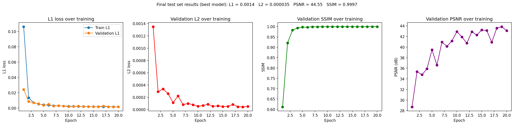
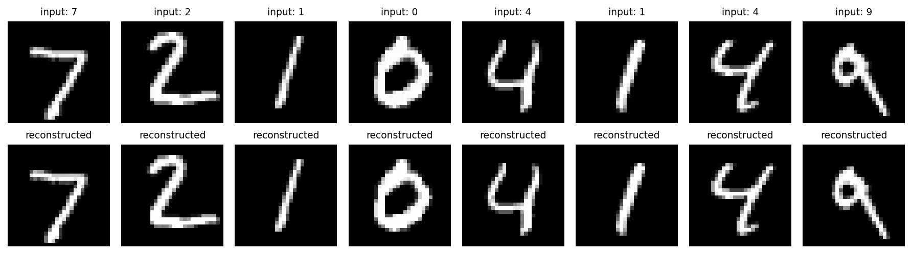

# NCDL Explainer: Trained Model

This repository hosts the trained model used by the **NCDL Explainer: Non-Cartesian Deep Learning Explained**, an interactive, visual companion to the paper *NCDL: A Framework for Deep Learning on Non-Cartesian Lattices* (Horacsek and Alim, NeurIPS 2023). The explainer was presented at VISxAI 2026 (IEEE VIS 2026).

## Read the explainer

- **Website (interactive):** <[LINK](https://visagg.cpsc.ucalgary.ca/ncdl-explainer/)>
- **Website source code:** <PASTE YOUR WEBSITE REPOSITORY LINK>

The explainer's Section 9 runs this model on an image you upload or a digit you draw, and shows the output of every layer.

## What this is

A small autoencoder, built entirely from the real NCDL library, trained to compress and reconstruct MNIST handwritten digits. The model's convolution, downsampling and upsampling layers run on a quincunx (checkerboard) lattice rather than an ordinary square grid, using NCDL's real, published code. (The model does not use pooling.)

## Which parts of NCDL this model uses

This model is built directly from the following real classes in the [NCDL library](https://github.com/jjh13/NCDL):

| Component | Source |
|---|---|
| `Lattice` | `ncdl/lattice/lattice.py` |
| `LatticeDownsample`, `LatticeUpsample` | `ncdl/nn/modules/resample.py` |
| `DoubleConv`, `OutConv` | `ncdl/modules/autoencoder.py` |
| `pad_like` | `ncdl/nn/functional/pad.py` |

No part of NCDL's own code has been copied into this repository. Install it directly from the source:
```bash
pip install git+https://github.com/jjh13/NCDL.git
```

## Architecture

A 10-layer encoder-decoder, alternating between the ordinary Cartesian grid and the quincunx lattice:

| # | Layer | Lattice | Shape (channels × height × width) |
|---|---|---|---|
| 1 | Input | Cartesian | 1 × 28 × 28 |
| 2 | Conv 1 | Cartesian | 16 × 28 × 28 |
| 3 | Downsample 1 | Cartesian → Quincunx | 16 × 14 × 14 (each of 2 cosets) |
| 4 | Conv 2 | Quincunx | 32 × 14 × 14 (each of 2 cosets) |
| 5 | Downsample 2 | Quincunx → Cartesian | 32 × 14 × 14 |
| 6 | Conv 3 (bottleneck) | Cartesian | 32 × 14 × 14 |
| 7 | Upsample 1 | Cartesian → Quincunx | 32 × 14 × 14 (each of 2 cosets) |
| 8 | Conv 4 | Quincunx | 16 × 14 × 14 (each of 2 cosets) |
| 9 | Upsample 2 | Quincunx → Cartesian | 16 × 28 × 28 |
| 10 | Conv 5 + output | Cartesian | 1 × 28 × 28 |

Total parameters: 46,689.

## Dataset

MNIST: 60,000 training images (54,000 train / 6,000 validation split) and 10,000 test images. Not included in this repository; downloaded automatically by `torchvision.datasets.MNIST(download=True)` the first time the training script runs.

## Training details

- **Task:** reconstruction (input digit → same digit)
- **Loss function:** L1 (mean absolute error)
- **Optimizer:** Adam, learning rate 0.001
- **Scheduler:** `ReduceLROnPlateau`, halving the learning rate after 3 epochs without validation improvement
- **Batch size:** 128
- **Epochs:** 20
- **Hardware:** NVIDIA RTX A6000

## Results

| Metric | Test set |
|---|---|
| L1 | *(fill in from your final run)* |
| L2 | *(fill in)* |
| PSNR | *(fill in)* |
| SSIM | *(fill in)* |

Training curves (left) and example reconstructions (right):




## Files in this repository

| File | What it is |
|---|---|
| `model_best.pt` | Trained weights (best validation checkpoint). This is the model the explainer uses |
| `train_model.py` | Full training script, including the model definition |
| `results.py` | Script that generates the result images |
| `training_metrics.json` | Complete per-epoch training history |
| `qualitative_results.png`, `quantitative_results.png` | Result images |
| `lattices_figure.png` | The lattices figure shown in the explainer's introduction. **Please do not move or rename it**: the notebook loads it from this address |

## Using this model

```python
import torch
from train_model import SmallQuincunxAutoencoder

model = SmallQuincunxAutoencoder()
model.load_state_dict(torch.load('model_best.pt'))
model.eval()
```

## How the website uses it

The website cannot run PyTorch, so the weights are converted once to the ONNX format (`model.onnx`, about 800 KB) and run inside the browser with ONNX Runtime Web. The converted file and the conversion scripts are in the website repository. Nothing the visitor uploads or draws leaves their browser.

## Citation and credits

- Horacsek and Alim (2023). [NCDL: A Framework for Deep Learning on Non-Cartesian Lattices](https://proceedings.neurips.cc/paper_files/paper/2023/hash/fab489de1a3224f0394d8f1d3c3213a8-Abstract-Conference.html). *Advances in Neural Information Processing Systems 36 (NeurIPS 2023)*.
- The [NCDL library](https://github.com/jjh13/NCDL) and its documentation at [ncdl.ai](http://ncdl.ai), by Joshua Horacsek.

## Authors

Mohammad Sakib Hossain and Usman Alim, [Visualization and Graphics Group](https://visagg.cpsc.ucalgary.ca), Department of Computer Science, University of Calgary.
